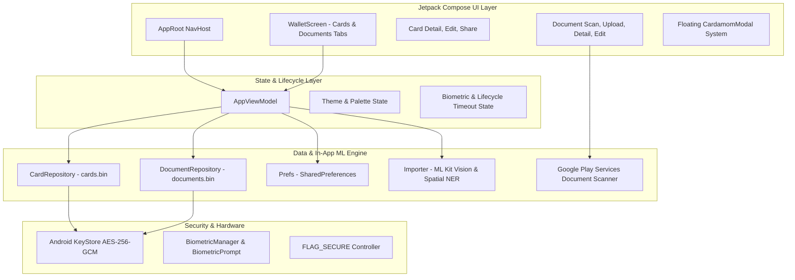
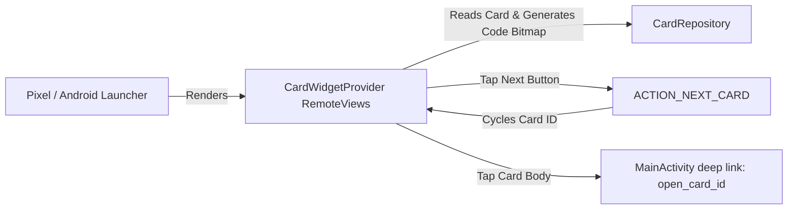

# Cardamom --- Complete Architecture, Feature & Navigation Specification

This document provides a comprehensive, technical specification of all
features, navigation screens, data models, security controls, and
hardware integrations currently implemented in the **Cardamom** Android
application (`com.shrivatsav.cardamom`).

------------------------------------------------------------------------

## Table of Contents

1.  [Application Overview &
    Architecture](#1-application-overview--architecture)
2.  [Data Models & Schema](#2-data-models--schema)
3.  [Local Persistence &
    Cryptography](#3-local-persistence--cryptography)
4.  [Design System, Theming &
    Typography](#4-design-system-theming--typography)
5.  [Custom Floating Modal
    Architecture](#5-custom-floating-modal-architecture)
6.  [Complete Navigation Graph & Screen
    Registry](#6-complete-navigation-graph--screen-registry)
7.  [Card Subsystem Specification](#7-card-subsystem-specification)
8.  [Document Subsystem
    Specification](#8-document-subsystem-specification)
9.  [Machine Learning & Analysis
    Engine](#9-machine-learning--analysis-engine)
10. [Home Screen AppWidget
    Subsystem](#10-home-screen-appwidget-subsystem)
11. [Security, Privacy & OS
    Integration](#11-security-privacy--os-integration)

------------------------------------------------------------------------

## 1. Application Overview & Architecture

Cardamom is a private, offline-first digital wallet and personal
document organizer built entirely using modern Android tools: \* **UI
Toolkit**: Jetpack Compose with Material 3. \* **Architecture**: Android
Architecture Components (ViewModel, StateFlow, Coroutines). \*
**Language & Toolchain**: Kotlin 2.3.20, Java 17, JVM Toolchain 17,
Target SDK 37, Min SDK 30. \* **Storage Philosophy**: 100% on-device
storage encrypted with hardware-backed Keystore keys. Zero server
tracking, zero external telemetry.

### 1.1 Gradle Modularization

The codebase is modularized for rapid incremental compilation, parallel build execution, and clear domain separation:
* `:core:model`: Lightweight data contracts (`WalletCard`, `WalletDocument`, `CardField`, `CodeFormat`, `AppOcrEngine`).
* `:core:util`: Low-level system utilities (`Codes`, `Files`, `Auth`, `Favicon`, `Prefs`).
* `:core:ui`: Shared design system (`Theme`, `CardamomPalette`, `Components`, `Modal`, fonts).
* `:core:vision`: Machine learning and computer vision pipeline (`OcrEngine`, `AiVisionEngine`, `AiModelManager`, `Importer`).
* `:app`: Presentation screens, navigation graph, ViewModels, Android widgets, and application manifests.


------------------------------------------------------------------------

## 2. Data Models & Schema

All core entities are defined in `Model.kt`.

### 2.1 `CodeFormat` (Enum)

Supported 1D and 2D barcode symbologies mapping to both ZXing
`BarcodeFormat` and Google ML Kit integer formats: \* `QR`: QR Code (2D)
\* `CODE128`: Code 128 (1D) \* `CODE39`: Code 39 (1D) \* `CODE93`: Code
93 (1D) \* `CODABAR`: Codabar (1D) \* `EAN13`: EAN-13 (1D) \* `EAN8`:
EAN-8 (1D) \* `UPCA`: UPC-A (1D) \* `UPCE`: UPC-E (1D) \* `ITF`:
Interleaved 2 of 5 (1D) \* `PDF417`: PDF417 (2D) \* `AZTEC`: Aztec Code
(2D) \* `DATAMATRIX`: Data Matrix (2D)

`is2D` returns `true` for `QR`, `PDF417`, `AZTEC`, and `DATAMATRIX`.

### 2.2 `LogoMode` (Enum)

Defines the visual badge displayed on a card tile: \* `AUTO`:
Automatically fetched site favicon or generated card initials. \*
`EMOJI`: Single emoji character selected by user. \* `IMAGE`: Custom
image file imported by user.

### 2.3 `CardField` (Data Class)

Key-value pair for arbitrary dynamic attributes extracted by the in-app
ML engine or defined manually: \* `label: String` (e.g., `"Department"`,
`"Validity"`, `"Seat"`, `"Points"`) \* `value: String` (e.g.,
`"Computer Science"`, `"09/2029"`, `"F-12"`, `"1,450"`)

### 2.4 `WalletCard` (Data Class)

Represents a card entry stored in the wallet: \* `id: String`: UUID
string identifier. \* `name: String`: Card title/name (left blank by
default for user specification). \* `issuer: String`: Issuing
organization, university, or company name (supports multi-line text). \*
`website: String`: Associated domain used for automated favicon
extraction. \* `category: String`: Categorization label (e.g.,
`"Library Card"`, `"Institutional ID"`, `"Movie Ticket"`,
`"Loyalty Card"`, `"Card"`). \* `code: String`: Encoded barcode/QR
payload (optional; cards can be saved without a code). \*
`format: CodeFormat`: The barcode format enum (default
`CodeFormat.CODE128`). \* `colorIndex: Int`: Randomly selected integer
indexing into `C.CardColors`. \* `seed: Int`: Deterministic seed for
generative card tile illustration canvas. \* `logoMode: LogoMode`:
Selected logo mode. \* `emoji: String`: Emoji string if
`logoMode == LogoMode.EMOJI`. \* `logoPath: String?`: Absolute path to
cached website logo PNG. \* `customPath: String?`: Absolute path to
user-imported logo PNG. \* `frontImagePath: String?`: Absolute path to
cropped photo of the card's front side. \* `backImagePath: String?`:
Absolute path to cropped photo of the card's back side. \*
`fields: List<CardField>`: Dynamic attributes list. \* `points: String`:
Legacy/direct points string. \* `status: String`: Legacy/direct tier or
status string. \* `originalPath: String?`: Path to imported source image
or PDF document. \* `originalName: String?`: Original display filename
of imported file. \* `originalMime: String?`: MIME type of imported
file. \* `isPinned: Boolean`: Whether this card is pinned at the top of
the wallet (maximum 1 card across wallet). \* `isDocument: Boolean`:
Flag distinguishing cards from standalone documents. \*
`createdAt: Long`: Millisecond Unix timestamp of creation.

### 2.5 `WalletDocument` (Data Class)

Represents a standalone document stored in the Documents repository: \*
`id: String`: UUID string identifier. \* `title: String`: User-facing
document title (e.g., `"Passport"`, `"Fall 2026 Transcript"`). \*
`docType: String`: Category (*National ID*, *Passport / Visa*,
*Educational Certificate*, *Receipt / Invoice*, *Exit Permit*, *Health /
Vaccine Record*, *Insurance Policy*, *Work Permit / Contract*,
*Document*). \* `issuer: String`: Issuing authority or institution name
(supports multi-line text). \* `uriPath: String`: File path to primary
document image or imported PDF. \* `mimeType: String`: MIME type
(`"application/pdf"` or `"image/jpeg"`). \* `pageCount: Int`: Total
count of pages in document. \* `pagePaths: List<String>`: List of
absolute file paths to JPEG images for each scanned page. \*
`pdfPath: String?`: Path to compiled multi-page PDF document generated
by scanner. \* `fileSize: Long`: Size of document file in bytes. \*
`isPinned: Boolean`: Whether the document is pinned to top of documents
list. \* `createdAt: Long`: Millisecond timestamp of creation. \*
`fields: List<CardField>`: Extracted or custom key-value attributes.

------------------------------------------------------------------------

## 3. Local Persistence & Cryptography

All persistence logic is encapsulated in `Storage.kt`.

### 3.1 Hardware-Backed `SecureStore`

-   **Algorithm**: `AES/GCM/NoPadding` (256-bit key).
-   **Key Storage**: AndroidKeyStore provider using alias
    `cardamom_key`.
-   **Payload Structure**: 12-byte IV prepended directly to the
    ciphertext and 128-bit authentication tag
    (`GCMParameterSpec(128, iv)`).
-   **Target Files**:
    -   `cards.bin`: Encrypted JSON array of all `WalletCard` objects.
    -   `documents.bin`: Encrypted JSON array of all `WalletDocument`
        objects.
-   **Corrupted File Safeguard**: If `store.decrypt()` throws an
    exception (e.g. system key invalidation), the corrupted binary is
    preserved as `cards_corrupted_<timestamp>.bin` before returning an
    empty list, preventing silent data overwrite.

### 3.2 Repositories

-   **`CardRepository`**: Thread-safe manager of `WalletCard` entries
    with reactive `StateFlow<List<WalletCard>>`. Automatically notifies
    home screen AppWidgets via `CardWidgetProvider.notifyUpdateAll(ctx)`
    upon any `upsert`, `saveAll`, or `delete`.
-   **`DocumentRepository`**: Independent manager of `WalletDocument`
    entries with reactive `StateFlow<List<WalletDocument>>`. Cleans up
    all referenced page images and PDF files from disk upon deletion.

### 3.3 Password-Protected `Backup` Subsystem

-   **File Header Magic**: String `"CARDAMOM1"`.
-   **Key Derivation**: `PBKDF2WithHmacSHA256` running **120,000
    iterations** with a 16-byte cryptographically secure random salt to
    derive a 256-bit AES key.
-   **Format**: `MAGIC + salt(16) + iv(12) + ciphertext_and_tag`.
-   **Export Payload**: Strips local filesystem paths to ensure portable
    import on other devices.

### 3.4 User Preferences (`Prefs`)

Stored in app-private `cardamom.xml` SharedPreferences: \*
`userName: String`: Display username. \* `userAvatarPath: String?`:
Absolute path to custom cropped user profile picture PNG. \*
`onboarded: Boolean`: Flag tracking whether initial walkthrough has been
completed. \* `lockEnabled: Boolean`: Master toggle for biometric /
device credential authentication. \* `lockTimeoutSeconds: Long`:
Inactivity grace duration before triggering lock (`0`, `15`, `60`,
`300`). \* `screenSecurity: Boolean`: Toggle enforcing `FLAG_SECURE`
against screenshots and recents snapshots. \* `illustrations: Boolean`:
Toggle enabling generative background patterns on card tiles. \*
`fetchLogos: Boolean`: Toggle permitting client-side favicon downloads
over HTTPS. \* `theme: String`: Active appearance theme (`"SYSTEM"`,
`"DARK"`, `"LIGHT"`). \* `pinnedCardId: String?`: Unique ID of the
single card pinned to the top of the Cards tab. \*
`pinnedDocId: String?`: Unique ID of the single document pinned to the
top of the Documents tab. \* `lastBackup: Long`: Timestamp of last
export.

------------------------------------------------------------------------

## 4. Design System, Theming & Typography

Implemented across `Theme.kt` and `Components.kt`.

### 4.1 Typography Scale

-   **Typeface**: `GoogleSansFlexFamily` loaded from
    `res/font/google_sans_flex.ttf`.
-   **Variable Font Axes**:
    -   `ROND = 100f`: Maximum rounded terminal styling across all
        glyphs.
    -   `wght`: Explicitly mapped across `FontWeight.Normal` (400),
        `Medium` (500), `SemiBold` (600), and `Bold` (700).
-   **Typography Roles**: 15 standard Material 3 roles wired into
    `CardamomTypography` and provided app-wide via `LocalTextStyle`.

### 4.2 Dynamic Color Palettes

                         ┌───────────────────────────────────┐
                         │          CardamomTheme            │
                         └─────────────────┬─────────────────┘
                                           │
                          isDark (System / Dark / Light)
                                           │
                        ┌──────────────────┴──────────────────┐
                        ▼                                     ▼
            ┌───────────────────────┐             ┌───────────────────────┐
            │      DarkPalette      │             │     LightPalette      │
            ├───────────────────────┤             ├───────────────────────┤
            │ bg:      #161616      │             │ bg:      #F8F6F1      │
            │ surface: #232323      │             │ surface: #FFFFFF      │
            │ text:    #FBF3E4      │             │ text:    #1A1917      │
            │ muted:   #A8A39A      │             │ muted:   #78746B      │
            │ outline: #3A3A3A      │             │ outline: #E4DFD5      │
            │ yellow:  #F5C842      │             │ yellow:  #E2B026      │
            │ danger:  #FF9C94      │             │ danger:  #DC362D      │
            └───────────────────────┘             └───────────────────────┘

-   **Composable Color Access**: Global `object C` exposes
    `@Composable get()` properties backed by
    `LocalCardamomPalette.current`, enabling dynamic zero-overhead theme
    switching.
-   **Card Pastel Palette**: Constant across themes:
    -   `Orange = #F6B04B`
    -   `Sage = #CFE0CC`
    -   `Mint = #A8D8B4`
    -   `Purple = #8B7CF6`
    -   `Pink = #F08A8A`

------------------------------------------------------------------------

## 5. Custom Floating Modal Architecture

Implemented in `Modal.kt`. Replaces all generic alert dialogs with a
bespoke, floating modal card detached from all four screen edges.

### 5.1 `CardamomModal` (Base Container)

-   **Floating Geometry**: Detached on all sides via
    `padding(horizontal = 16.dp, vertical = 20.dp)` with top status bar
    and bottom navigation bar insets.
-   **Shape & Elevation**: `RoundedCornerShape(28.dp)` across all 4
    corners, layered with a 20dp drop shadow over a 65% black scrim.
-   **Neutral Dark Palette**: `tonalElevation = 0.dp` avoids Material 3
    yellow cast; uses neutral `#1C1C1E` in dark mode and `#FFFFFF` in
    light mode, enclosed by a `1.5.dp` border.
-   **Drag Indicator**: Centered 36x4dp rounded pill handle at top.

### 5.2 Specialized Modal Variants

-   **`CardamomSelectModal<T>`**: Displays options as raised/muted
    pills. Selected options feature a raised dark surface, a 2dp gold
    border, and a circular gold checkmark badge.
-   **`CardamomConfirmModal`**: Confirmation sheet for destructive
    operations (e.g., deleting cards or documents) with a red
    confirmation button.
-   **`CardamomLinkModal`**: Sheet for viewing raw QR/barcode payloads
    with a one-tap "Copy to clipboard" button.

------------------------------------------------------------------------

## 6. Complete Navigation Graph & Screen Registry

Implemented in `App.kt` using `androidx.navigation.compose.NavHost`.

  ------------------------------------------------------------------------
  Route                   Composable Function      Purpose / Description
  ----------------------- ------------------------ -----------------------
  `w1`                    `WelcomeScreen`          Initial onboarding
                                                   screen: branding, hero
                                                   card fan animation, and
                                                   "Get started" button.

  `w2`                    `ScanIntroScreen`        Second onboarding
                                                   screen: visual
                                                   illustration of code
                                                   scanning capabilities
                                                   and "Next" button.

  `w3`                    `UsernameScreen`         Profile setup: custom
                                                   profile photo picker,
                                                   username field, and app
                                                   lock toggle.

  `w4`                    `ModelDownloadScreen`    On-device AI setup:
                                                   communicates active on-device
                                                   Google ML Kit engine as
                                                   default with zero blocking downloads.

  `w5`                    `SetupCompleteScreen`    Setup complete screen:
                                                   displays configuration
                                                   summary (owner, lock, Google
                                                   ML Kit OCR active) with 1-tap
                                                   buttons to start adding
                                                   cards or enter the wallet.

  `wallet`                `WalletScreen`           Main home screen:
                                                   dual-tab interface
                                                   ("Cards" &
                                                   "Documents"), search
                                                   bar, user avatar, and
                                                   pinned card.

  `scan` /                `ScanScreen`             Live camera scanner:
  `scan?doc={doc}`                                 custom ID-1 card cutout
                                                   frame, 2-step (Front &
                                                   Back) card capture, and
                                                   photo/file import.

  `review`                `ReviewScreen`           Post-scan card
                                                   inspection: front/back
                                                   thumbnail switcher,
                                                   category, issuer, and
                                                   dynamic attributes.

  `edit/{id}`             `EditScreen`             Card editor: manual
                                                   title, 2-line
                                                   institution, category,
                                                   website, colors, logos,
                                                   and custom attributes.

  `detail/{id}`           `DetailScreen`           Full card view: 3D
                                                   flippable digital card
                                                   (fixed geometry, raised
                                                   corner with peeking circular
                                                   arrow button) and 2-tab
                                                   layout: "Digital card" vs
                                                   "Photo / File" (with in-app
                                                   full-screen viewer).
  `share/{id}`            `ShareScreen`            Card sharing: export as
                                                   rendered card PNG
                                                   image, raw encrypted
                                                   `.cardamom` file, or
                                                   save to gallery.

  `scan_doc`              `DocumentScanScreen`     Document import: Google
                                                   Play Services Document
                                                   Scanner launcher, PDF
                                                   importer, and gallery
                                                   picker.

  `doc_upload`            `DocumentUploadScreen`   Document review: swipable
                                                   edge-to-edge preview
                                                   (HorizontalPager, zero white
                                                   lines), automatic ML Kit
                                                   issuer extraction, suggested
                                                   attribute chips, title input,
                                                   and doc type picker.
  `doc_detail/{id}`       `DocumentDetailScreen`   Document viewer:
                                                   renders actual scanned
                                                   pages/PDFs with
                                                   full-screen zoom,
                                                   document attributes,
                                                   and share.

  `doc_edit/{id}`         `DocumentEditScreen`     Document metadata
                                                   editor: modify title,
                                                   type, authority, and
                                                   custom attributes.

  `settings`              `SettingsScreen`         App configuration:
                                                   profile details & avatar,
                                                   app lock toggle, lock timeout,
                                                   screen security, theme modal,
                                                   and in-app Privacy Policy &
                                                   Terms of Service modals.
  `backup`                `BackupScreen`           Encrypted file export &
                                                   import: password
                                                   encryption, JSON
                                                   export, and full wallet
                                                   restoration.

  *(Overlay)*             `UnlockScreen`           Full-screen security
                                                   barrier active whenever
                                                   `vm.locked == true`.
                                                   Enforces biometric /
                                                   device credentials.

  *(Overlay)*             `BusyOverlay`            Non-blocking modal
                                                   loading spinner with
                                                   status text shown
                                                   during long IO or ML
                                                   operations.
  ------------------------------------------------------------------------

------------------------------------------------------------------------

## 7. Card Subsystem Specification

Implemented in `ScreensMain.kt`, `ScreensCard.kt`, and `Components.kt`.

### 7.1 Single Pinned Hero Card (Always Open at Top of Cards Tab)

-   Enforced by `AppViewModel.pinnedCardId`: Only **one** card can be
    pinned at any time on the Cards tab.
-   Renders at index 0 of the **Cards tab** with `expanded = true`
    **permanently**: its barcode, loyalty balance, or attributes remain
    expanded and ready to scan immediately.
-   Labeled with a gold pin icon and `"Pinned"` label with a dark pill
    `"Unpin"` button.
-   Tapping on the barcode/QR code on the home screen card opens
    `DetailScreen`. In `DetailScreen`, tapping the QR code again opens
    the `"Code contents"` copy modal.
-   Tapping the 5-point gold star icon on any card's detail screen
    immediately pins that card and unpins any prior selection.

### 7.2 Custom Two-Way Scanner (Front & Back of Card)

-   **Viewfinder Frame (`CardFrameOverlay`)**: Renders an exact ID-1
    card cutout ($1.586 : 1$ aspect ratio) with 24dp rounded corners,
    outer canvas dimming, and real-time green border highlight when
    barcodes are detected.
-   **Two-Step Guided Flow**:
    -   *Step 1 (Front)*: Prompts to align front of card. Tapping
        **"Capture Front"** crops the bitmap strictly to the card frame.
    -   *Step 2 (Back)*: Viewfinder switches to back framing. Tapping
        **"Capture Back"** crops the back side, or tapping **"Skip back
        side"** proceeds with front-only data.
-   **Storage**: Cropped card images are stored locally as
    `card_<id>_front.jpg` and `card_<id>_back.jpg`.

### 7.3 Multi-View Card Inspection (`DetailScreen`)

-   **Header**: Two-line hero typography (`maxLines = 2`,
    `lineHeight = 26.sp`) for long university and corporate names.
-   **View Mode Selector**: If scanned photos exist, tabs toggle
    between:
    1.  `Digital card`: High-contrast vector styling with screen
        brightness boost and barcode.
    2.  `Front photo`: High-resolution cropped image of the card's front
        side.
    3.  `Back photo`: High-resolution cropped image of the card's back
        side.
-   **Code-Optional Handling**: Cards without barcodes omit the code
    container entirely.
-   **Two-Line Attributes (`CardAttributeTwoLine`)**: Fields such as
    Institution, Company, or values exceeding 22 characters render with
    a small uppercase label on line 1 and full-width multi-line text on
    line 2.

### 7.4 Home Screen Card Tile (`CardTile`)

-   **Direct Typography**: Omits generic avatar initials and icons in
    front of names; titles and issuers start cleanly aligned to the card
    edge.
-   **Minimized State**: Displays 2-line title/issuer and a **mini
    barcode/QR code preview** in the top-right corner.
-   **Expanded State**: Smoothly unfolds inline to show the full-size
    `CodePanel` and `CardFieldsRow`. Tapping the QR code opens the card
    detail screen.

### 7.5 Responsive Card Fields Formatting (`CardFieldsRow`)

-   **Collision-Free Dynamic Layout**: Resolves horizontal text
    collision when multiple attributes are detected.
-   **Long Attribute Separation**: Fields with values exceeding 16
    characters (such as department or branch names like *"Computer
    Science & Engineering"*) automatically occupy their own full-width
    row with dedicated upper-label and bold multi-line text.
-   **Compact Attribute Grid**: Shorter attributes (such as *"Course:
    B.E"* or *"Validity: 2025-2029"*) render in a balanced 2-column
    weighted grid (`weight(1f)`) preventing horizontal overlap.
-   **Attribute Deduplication**: Automatically deduplicates synonymous
    fields with identical values (e.g. Branch vs Department).

### 7.6 3D Interactive Flippable Digital Card

-   **Physical Card Simulation**: Replicates the feel of a real physical card with 3D perspective rotation.
-   **Swipe & Tap Gestures**: Flips 180° around the Y-axis via horizontal drag gesture (`detectHorizontalDragGestures`) or direct tap.
-   **Strict Fixed Geometry**: Both the Front and Back faces use `Modifier.fillMaxSize()` inside an exact fixed container (`height = 310.dp` with barcode, `240.dp` without), ensuring zero jumping or height shifts during flipping.
-   **Two Distinct Faces**:
    -   *Front Face*: H1 Title, Institution Subtitle, Barcode/QR Code panel, and key front attributes (*USN*, *Course*, *Branch*, *Validity*).
    -   *Back Face*: Mirrored upright (`rotationY = 180f`) with high-contrast bold typography for *Date of Birth*, *Mobile No*, full *Address*, *Blood Group*, and *Transferability* status.
-   **Raised Corner & Peeking Arrow Button**:
    -   The card container features a physical-look tilt/rise on the right corner (`rotationZ = -1.2f` on front, `1.2f` on back).
    -   A static circular action button (`CircleShape`, 52dp, `C.Yellow`) sits underneath on the right, half-exposed and flushed ~30% below the card edge (`[card]->`), clearly indicating the card has a back and inviting interaction.

### 7.7 Two-Tab Detail Screen (`Digital card` vs `Photo / File`)

-   **Dual-Tab Interface**: Replaces confusing multi-photo tabs with exactly two clear modes:
    1.  *Digital card*: The interactive 3D flippable digital card.
    2.  *Photo / File*: Displays the original camera photo(s) in their true aspect ratio with a clean `[ Front photo | Back photo ]` switcher.
-   **In-App Full-Screen Inspection**: Tapping any card photo opens it in `InAppFileViewerDialog` with pan/zoom and close controls.
-   **Original File Integration**: Prominent file card for imported PDFs and images with a one-tap button to view directly in app.

------------------------------------------------------------------------

## 8. Document Subsystem Specification

Implemented in `ScreensDocument.kt`.

### 8.1 Complete Architectural Separation

Documents represent distinct legal, educational, and financial records
and do not share card styling, seeds, or barcode panels.

### 8.2 Document Capture (`DocumentScanScreen`)

1.  **Google Play Services Document Scanner**:
    -   Uses `GmsDocumentScanning.getClient()` configured with
        `SCANNER_MODE_FULL`, `setGalleryImportAllowed(true)`, and
        `setPageLimit(20)`.
    -   Automatically executes document corner detection, perspective
        unwarping, shadow removal, and generates both clean page JPEGs
2.  **Multi-Page Camera Capture with Stacked Controls**:
    -   *Top*: Full-width primary **"Capture Page X"** action button (`56dp` height).
    -   *Bottom Left*: Half-width **Page Count** tile (`52dp` height) showing live captured count.
    -   *Bottom Right*: Half-width **Done** button (`52dp` height) highlighted in green once $\ge 1$ page is captured to finish and advance directly to review.
3.  **Multi-Photo Gallery Import**: Imports multiple photos
    simultaneously via `ActivityResultContracts.GetMultipleContents()`
    to assemble multi-page documents.
4.  **Import PDF**: Opens system file picker for native multi-page PDF
    documents.

### 8.3 Document Upload Screen (`DocumentUploadScreen`)

-   Triggered immediately upon capture or file selection (no silent
    auto-saving).
-   **Manual Title Requirement**: Document title is strictly blank by
    default and is never auto-filled, requiring explicit user naming.
-   **Multi-Page Swipable Carousel (HorizontalPager)**:
    -   Smooth touch swiping across pages directly in the preview container.
    -   Edge-to-edge `ContentScale.Crop` framing inside `#141414` backing with **zero white letterbox lines at the sides**.
    -   "+ Add more pages" button allowing appending additional photos.
    -   "Remove page" option to discard unwanted or blurry pages before saving.
-   **On-Device ML Kit Issuer Extraction**:
    -   Automatically analyzes captured pages locally to extract the issuing authority.
    -   Omits raw unstructured text dumping into fields.
-   **Suggested Attribute Chips**:
    -   Provides 1-tap chips (*Document No*, *Date of Issue*, *Expiry Date*, *Holder Name*, *Account No*, *Reference No*) allowing users to selectively add attributes if necessary, with full inline editing and deletion.
-   Prompts the user for:
    -   **Document title \***: Required custom user-defined name.
    -   **Document type**: Selectable modal (*National ID*, *Passport /
        Visa*, *Educational Certificate*, *Receipt / Invoice*, *Exit
        Permit*, *Health Record*, *Insurance*, *Contract*, *Document*).
    -   **Issuing authority / Organization**: Multi-line organization
        name.
-   Action button: **"Upload document"** (enabled only when Title and
    Type are non-blank) persists the record into the encrypted document
    vault.

### 8.4 Document Viewer (`DocumentDetailScreen`)

-   **Multi-Page Interactive Flipping**: Full-width document preview
    with previous/next page navigation controls (`Page X of Y`),
    allowing users to browse all pages of multi-photo documents directly
    in the detail view.
-   **Rearranged Layout**: Positions the **TYPE & ISSUER details card
    directly below the top bar**, placing key metadata at the top of the
    screen before the document preview.
-   **Native Aspect Ratio (No Zoom/Cropping)**: Displays the document
    page in its exact original aspect ratio (16:9, 9:16, 4:3, etc.)
    using `ContentScale.Fit`, ensuring zero distortion, zoom, or
    clipping.
-   **Tap-to-Zoom**: Tapping the document container launches
    `DocumentFullViewerDialog`, displaying all pages in an interactive,
    full-screen viewer.
-   **Share**: One-tap native sharing via Android `FileProvider`.

### 8.5 Inline Home Screen Document Previews & Single Pinned Hero Document

-   **Single Pinned Hero Document**: Enforced by
    `AppViewModel.pinnedDocId`: Only **one** document can be pinned at
    any time on the Documents tab. Renders permanently expanded at index
    0 of the Documents tab with a gold pin icon, `"Pinned"` label, and
    an `"Unpin"` button.

-   **Responsive Full Image View**: When expanded, removes the split
    one-page layout. The document image is displayed full-width,
    dynamically scaling to landscape or portrait/vertical proportions as
    the image takes.

-   ## **1-Tap Navigation**: Tapping the document image or the black pill **"View"** button navigates directly to `DocumentDetailScreen`.

## 9. Machine Learning & Analysis Engine

### 9.1 Architectural Direction

The Cardamom Android application remains the production host for
document capture, review, encrypted storage, and user interaction. The
AI research and training system is a **separate project and
repository**. It is not built inside the Android Gradle project and is
not required to build or run Cardamom.

The separate AI project produces versioned, portable model artifacts.
Cardamom consumes those artifacts through a documented model-package
contract. No Python interpreter, training framework, notebook, dataset,
or training dependency is shipped in the Android application.

The AI pipeline must be fully on-device at inference time. Once the
required model packages have been installed, OCR and document
understanding must not require a network connection, cloud API, account,
or remote inference service.

### 9.2 Responsibilities and Existing Android Integration Points

The following existing files retain their responsibilities, with
implementation changes as needed:

-   **`OcrEngine.kt`**: Common OCR engine abstraction (`OcrEngine`,
    `GoogleMlKitOcrEngine`, `PaddleOcrEngine`, `OcrEngineProvider`,
    `OcrResult`). Normalizes differences between Google ML Kit (default)
    and PaddleOCR (alternative) into common blocks, lines, and bounding
    boxes.
-   **`AiModelManager.kt`**: Model package catalog, installation/import,
    version checks, integrity verification, storage, activation,
    rollback, and lifecycle for optional PaddleOCR packages.
-   **`AiVisionEngine.kt`**: Semantic document understanding engine.
    Consumes normalized `OcrResult` from whichever OCR engine is active,
    executing layout analysis, entity extraction, multi-key splitting,
    relationship resolution, and normalization.
-   **`Importer.kt`**: Orchestrates card/document input, image/PDF page
    preparation, barcode scanning (ZXing/ML Kit), AI calls, and manual
    fallback. Ensures `card.code` is strictly populated from actual
    scanned barcodes and never invented from ID numbers.
-   **`Model.kt`**: Existing `CardField` remains supported. Add
    versioned structured extraction result types only where needed,
    without breaking existing persisted `WalletCard` or `WalletDocument`
    records.
-   **`AppViewModel.kt`**: Exposes model readiness, processing state,
    errors, and extraction results to the UI.

The current barcode subsystem remains separate from OCR. ZXing /
existing barcode functionality must continue to work even if AI models
are unavailable.

The current Google Play Services document scanner may remain as an
optional capture provider. It is not the AI inference engine. If fully
offline capture is required on a device without the relevant Play
Services capability, Cardamom must retain or provide its local CameraX /
gallery / PDF import route. Do not describe a Play Services-dependent
capture flow as guaranteed offline.

### 9.3 Independent AI Project

Create a separate repository/project, provisionally named `cardamom-ai`,
with Python-based training, inference, evaluation, export, and
integration tooling. It must be runnable and testable without Android
Studio.

The AI project is divided into independently testable modules. Each
module must expose: 1. A documented input schema and output schema. 2. A
configuration object or configuration file. 3. A deterministic inference
entry point. 4. Unit tests and representative fixtures. 5. An evaluation
command that reports task-specific metrics. 6. A model export command
when the module contains learned weights. 7. A model card describing
training data, licenses, supported scripts/languages, limitations, and
evaluation results.

Required module boundaries:

-   **Image preprocessing**: image decode, EXIF orientation, rotation,
    perspective correction, resize, denoise, contrast normalization,
    blur/quality checks. Keep deterministic image transforms separate
    from learned models.
-   **Script/language detection**: estimate writing system and likely
    language per page or region. Support mixed-script pages and an
    `unknown` result; do not force a language prediction.
-   **Text detection**: return text-region polygons or bounding boxes
    with normalized coordinates and detection confidence.
-   **Printed-text recognition**: recognize text crops and return text,
    confidence, script/language metadata, and alignment to source
    regions.
-   **Handwriting recognition**: separate recognition path, initially
    prioritizing benchmarked languages/scripts. It must be independently
    testable and must not be represented as universally multilingual
    until measured.
-   **Document classification**: classify supported document families
    such as identity documents, certificates, business cards, bank
    statements, invoices/receipts, forms, tables, and unknown.
-   **Layout analysis**: detect headings, paragraphs, labels, key-value
    regions, tables, footers, and reading order.
-   **Table structure recognition**: detect rows, columns, cells,
    headers, merged cells where supported, and cell-to-text
    associations.
-   **Entity extraction**: identify semantic entities such as person,
    organization, date, identifier, contact, address, location, money,
    currency, and arbitrary labeled values.
-   **Relationship resolution**: associate labels with values using
    text, proximity, alignment, reading order, and document context.
    Preserve ambiguity rather than inventing a relationship.
-   **Normalization and validation**: normalize dates, numbers,
    currency, phone numbers, and identifiers only when unambiguous;
    preserve original text and flag uncertain transformations.
-   **Pipeline orchestration**: compose modules while retaining each
    stage's raw output, timing, confidence, and errors for debugging.

Use pretrained models and fine-tuning where appropriate. Do not train
large OCR systems from scratch without a documented experiment
demonstrating why it is necessary. Model choices are candidates, not
hard-coded assumptions: benchmark current lightweight OCR candidates
(including relevant PaddleOCR PP-OCR families and other viable open
models) on the project's own evaluation set before selecting them.
Verify model licenses and redistribution terms before including weights.

### 9.4 Hardware-Aware Development and Training

Initial development hardware:

-   CPU: AMD Ryzen 7 4800H.
-   GPU: NVIDIA RTX 3050 with 4 GB VRAM.
-   RAM: 16 GB.
-   Storage: approximately 512 GB NVMe SSD.
-   Development OS: Windows 11.

The project must be practical on this machine. Prefer small models,
transfer learning, mixed precision where supported, conservative batch
sizes, gradient accumulation, dataset streaming/caching controls, and
CPU fallbacks. Training scripts must expose batch size, image size,
worker count, precision, and device as configuration. Do not assume that
every training stage fits in 4 GB VRAM. Document when a stage requires
reduced settings or optional rented compute.

The target Android devices are not specified by this document.
Therefore, do not claim a universal latency, RAM, or package-size
guarantee. Measure on representative Android hardware before setting
release thresholds.

### 9.5 Model Package and Export Contract

The AI project must export a self-contained, versioned package that can
be imported by Cardamom without the source repository or Python
environment.

Recommended package layout:

``` text
cardamom-ai-release/
├── manifest.json
├── checksums.sha256
├── README-model.md
├── licenses/
├── models/
│   ├── image_preprocess/
│   ├── script_detection/
│   ├── text_detection/
│   ├── printed_recognition/
│   ├── handwriting_recognition/
│   ├── document_classifier/
│   ├── layout_analysis/
│   ├── table_structure/
│   ├── entity_extraction/
│   └── relationship_resolution/
├── vocab/
├── labels/
├── configs/
└── test-fixtures/
```

Only modules required by a particular release need to be present. The
manifest must declare: \* Package ID, package version, schema version,
build timestamp, and minimum engine API version. \* Each module ID,
version, artifact path, file size, SHA-256, format, runtime, and
required operators or runtime capabilities. \* Input/output tensor
names, shapes, data types, color order, normalization, resize policy,
and coordinate conventions. \* Vocabulary, label-map, tokenizer, and
character-dictionary paths and hashes where applicable. \* Supported
languages/scripts, document classes, handwriting coverage, known
limitations, and evaluation metrics. \* Model license, source project,
attribution, and redistribution notices. \* Quantization type and
whether the artifact is intended for CPU, XNNPACK, NNAPI, or another
explicitly tested execution provider.

Prefer ONNX for modules that export cleanly and run correctly in the
selected Android runtime. ONNX is a deployment target, not an assumption
that every model can be converted losslessly. Preserve a supported
alternative runtime/artifact format when conversion is not viable, and
declare it in the manifest. Export validation must compare
source-framework and exported-model outputs within documented
tolerances.

Package integrity is mandatory: verify SHA-256 for every artifact before
loading. A package with an unsupported schema, missing dependency,
incompatible runtime, invalid checksum, or incompatible model interface
must be rejected without replacing the currently active working package.

### 9.6 Android Model Runtime and Lifecycle

`AiModelManager.kt` manages package installation and activation. It must
support: \* Bundled starter package and/or user-initiated local package
import. \* Optional download of additional model packs, with progress,
cancellation, resumability where practical, and checksum verification.
\* Package listing, installed size, language/script coverage, version,
and compatibility status. \* Atomic activation: stage and validate a new
package before switching the active version. \* Rollback to the previous
valid package. \* Safe deletion of unused packs without deleting an
active or in-use package. \* Offline operation after installation.

`AiVisionEngine.kt` provides a stable Kotlin-facing interface
independent of the selected inference runtime. It must: \* Load only
manifest-declared modules. \* Run inference off the main thread. \*
Support cancellation and page-level progress. \* Release native sessions
and image buffers. \* Return structured errors rather than crashing the
application. \* Expose per-stage timings and confidence for diagnostics.
\* Avoid logging document contents or sensitive extracted values.

Start with ONNX Runtime Android as a candidate runtime and benchmark
CPU/XNNPACK first; evaluate NNAPI only on real devices and only where it
improves measured performance. A PaddleOCR Android SDK/runtime route is
also acceptable if its current exported models, operators, licensing,
package size, and integration quality are better. Runtime selection must
be based on a working end-to-end Android proof of concept, not
preference alone.

### 9.7 Unified Pipeline Result

The Android-facing result must preserve both raw recognition and
structured understanding. A suggested logical schema is:

``` json
{
  "schema_version": "1.0",
  "document": {
    "type": "bank_statement",
    "type_confidence": 0.94,
    "pages": 2,
    "languages": ["en"],
    "scripts": ["Latin"]
  },
  "text_blocks": [
    {
      "id": "block_001",
      "text": "Statement Date: 01/11/2026",
      "confidence": 0.97,
      "kind": "printed",
      "page": 0,
      "polygon": [[0.1, 0.2], [0.8, 0.2], [0.8, 0.24], [0.1, 0.24]]
    }
  ],
  "fields": [
    {
      "id": "field_001",
      "key": "statement_date",
      "label": "Statement Date",
      "type": "date",
      "value": "2026-11-01",
      "original_value": "01/11/2026",
      "confidence": 0.94,
      "verified": false,
      "source_block_ids": ["block_001"]
    }
  ],
  "tables": [],
  "warnings": [],
  "processing": {
    "engine_version": "1.0",
    "package_version": "1.0.0",
    "stage_timings_ms": {}
  }
}
```

Coordinates must use one documented normalized coordinate system. The
example is illustrative; the implementation must define whether
coordinates are relative to the original page, corrected page, or both.
Preserve a mapping back to the displayed source page so review
highlights align correctly.

The schema must support arbitrary field labels and types, unknown
document types, multiple values, repeated entities, multi-page
documents, table cells, and uncertain/ambiguous results. Never discard
OCR text merely because semantic extraction failed.

### 9.8 Document-Specific Requirements

-   **Identity documents and certificates**: extract names, issuing
    authority, document/certificate identifiers, dates, qualifications,
    and arbitrary labeled fields. Do not claim authenticity
    verification. Treat highly sensitive identifiers carefully and avoid
    unnecessary duplication.
-   **Business cards**: extract person, organization, designation,
    phone, email, website, and address. Preserve multiple phone
    numbers/emails.
-   **Bank statements**: extract account-holder and statement metadata
    where present; reconstruct transaction tables with date,
    description, debit, credit, and balance where those columns exist.
    Do not assume a fixed bank format or fixed column order. Arithmetic
    checks may flag discrepancies but must never silently modify
    extracted values.
-   **Tables and spreadsheet-like documents**: retain row/column
    relationships, headers, empty cells, and merged cells where
    supported. For native XLSX/CSV and text-based PDFs, prefer native
    parsers over OCR; use OCR for scanned or image-only pages.
-   **Handwriting**: mark recognition origin as handwritten and retain
    confidence. Low-confidence text must be reviewable. Language/script
    coverage must be explicitly reported rather than generalized.

### 9.9 Independent Testing and Integrated Validation

Every module must be testable without the rest of the pipeline. The AI
project must include: \* Unit tests for preprocessing, geometry,
decoding, normalization, schema validation, and error handling. \*
Golden-image fixtures with expected text, regions, labels, and table
structures. \* Module-specific evaluation commands and machine-readable
reports. \* Regression tests that compare new model versions against a
fixed evaluation set. \* Integration tests that run the complete
document pipeline from image/PDF input to the unified result. \* Stress
tests for multi-page PDFs, large images, rotated pages, blur, low light,
mixed scripts, and malformed inputs. \* Export parity tests comparing
source-framework inference with exported inference. \* Android
compatibility smoke tests using the actual exported package and target
runtime.

Report at minimum: \* OCR character error rate (CER) and word error rate
(WER), separated by language/script and printed/handwritten source. \*
Text detection precision/recall or an appropriate region metric. \*
Document classification macro-F1 and unknown-class behavior. \* Entity
extraction precision/recall/F1 by entity type. \* Key-value association
accuracy. \* Table structure/cell accuracy. \* Model/package size, peak
memory, cold-start time, per-page latency, and battery impact on
physical Android devices.

A module is not complete merely because its code runs. It must have
fixtures, a repeatable test command, an evaluation report, and a
documented limitation statement.

### 9.10 Manual Review and Fallback

AI suggestions must remain editable. Low-confidence or ambiguous fields
must be highlighted for user review. Preserve the original OCR text and
source region so the user can inspect where a field came from.

If a model package is absent, incompatible, corrupt, or fails at
runtime: \* Keep barcode scanning operational. \* Keep manual
card/document entry operational. \* Do not silently create fabricated
field values. \* Explain that AI extraction is unavailable and provide a
retry/model-management route. \* Never lose the imported original
document because inference failed.

### 9.11 Privacy and Offline Guarantee

All model inference and document understanding occur locally. Network
access may be used only for an explicitly user-initiated model-package
download or update. No document image, OCR text, extracted field, or
bank-statement content may be sent to a server.

The engine must not include telemetry, analytics, crash payloads
containing document content, or hidden upload functionality. Model
downloads must be separate from inference and must be optional after the
required package has been installed.

### 9.12 Current Engine Status and Migration

The current documentation describes a PP-OCRv4-based approximately 15.8
MB in-app model and spatial/entity heuristics. Treat that as the
existing implementation baseline, not as the specification for the new
standalone AI project.

Migration must be incremental: 1. Preserve the existing Cardamom storage
format and user data. 2. Define the Kotlin engine interface and package
manifest. 3. Build and test the external Python AI project
independently. 4. Export a first compatible package and validate it
outside the app. 5. Integrate the package loader and inference adapter
behind the existing `AiVisionEngine` boundary. 6. Keep the old engine
available behind a temporary development fallback until the new engine
passes parity and regression tests. 7. Remove legacy inference only
after successful validation and an explicit migration decision.

Do not rewrite navigation, card presentation, document presentation,
backup, encryption, widgets, or unrelated app features as part of the AI
migration.

------------------------------------------------------------------------

## 10. Home Screen AppWidget Subsystem

Implemented in `CardWidgetProvider.kt`,
`CardWidgetConfigureActivity.kt`, and `res/layout/widget_card.xml`.



### 10.1 Live Code & Barcode Preview

-   Renders the card's actual 1D barcode or 2D QR code at high
    resolution directly on the home screen using `Codes.bitmap(...)`.
-   Displays card background color, 2-line title/issuer, and category.

### 10.2 Custom Configuration Activity (`CardWidgetConfigureActivity`)

-   Launched when adding a widget.
-   Built in Jetpack Compose: shows all wallet cards with expandable
    previews, allowing the user to pick which card appears on that
    specific widget instance.
-   Instance mapping is persisted via `cardamom_widgets.xml`
    SharedPreferences (`card_widget_<appWidgetId>`).

### 10.3 In-Widget Card Cycling

-   Tapping the top-right button on the widget triggers
    `ACTION_NEXT_CARD`, cycling to the next card in the wallet and
    updating the live barcode preview without opening the app.

### 10.4 1-Tap Deep Linking

-   Tapping the widget body launches `MainActivity` with `open_card_id`,
    opening the card's detail view directly with full screen brightness
    boost.

------------------------------------------------------------------------

## 11. Security, Privacy & OS Integration

### 11.1 Biometric & Lifecycle Authentication

-   Handled via `Auth.prompt` using AndroidX `BiometricPrompt` with
    `BIOMETRIC_STRONG or DEVICE_CREDENTIAL`.
-   **Configurable Lock Timeout**: Enforced by
    `AppViewModel.onBackground()` and `onForeground()`:
    -   `Immediately`: Locks as soon as the app enters the background.
    -   `15 seconds`: Grace period allowing quick app switching.
    -   `1 minute` / `5 minutes`: Extended grace durations.

### 11.2 Screen Security (`FLAG_SECURE`)

-   Toggled via **Settings $\to$ Security $\to$ "Block screenshots &
    recents"**.
-   Dynamically sets `WindowManager.LayoutParams.FLAG_SECURE` in
    `MainActivity` whenever screen security is active or whenever the
    app is locked.
-   **Protection**: Blocks screenshots and blanks out the app preview in
    the Android Recent Tasks (Overview) switcher.

### 11.3 System Bar Styling & Navigation Insets

-   Full edge-to-edge layout via `enableEdgeToEdge()`.
-   Automatically toggles status bar icons and navigation bar handle
    between light and dark according to the active theme.
-   All screens and floating modals consume `systemBarsPadding()`,
    `navigationBarsPadding()`, and `imePadding()` to prevent UI overlap.

### 11.4 Launcher App Shortcuts

-   Registered in `res/xml/shortcuts.xml`: Long-pressing the app icon
    exposes the **"Scan Card"** shortcut, navigating directly to the
    camera scanner in one tap.

### 11.5 Material You Themed Icon

-   `res/mipmap-anydpi-v26/ic_launcher.xml` and `ic_launcher_round.xml`
    include
    `<monochrome android:drawable="@drawable/ic_launcher_foreground" />`,
    adapting to wallpaper color palettes on Android 13+.

------------------------------------------------------------------------

## Summary of Key Source Files

    cardamom/app/src/main/
    ├── AndroidManifest.xml                        # Manifest, permissions, activities, receivers, FileProvider
    ├── java/com/shrivatsav/cardamom/
    │   ├── App.kt                                # MainActivity, NavHost routes, lifecycle, edge-to-edge
    │   ├── AppViewModel.kt                       # Observable state, card/doc operations, theme, lock timeout
    │   ├── Model.kt                              # WalletCard, WalletDocument, CardField, CodeFormat, JSON
    │   ├── Storage.kt                            # SecureStore (AES-GCM), CardRepository, DocumentRepository, Backup
    │   ├── OcrEngine.kt                          # Common OCR engine abstraction (Google ML Kit default vs PaddleOCR)
    │   ├── AiModelManager.kt                     # On-device model catalog, HTTP downloader with progress, storage & lifecycle
    │   ├── AiVisionEngine.kt                     # Semantic document understanding, layout analysis & entity extraction
    │   ├── Importer.kt                           # Multi-format scanner, two-way card analysis, PDF renderer, model gating
    │   ├── Util.kt                               # Auth (Biometrics), Codes (ZXing), Files, Favicon (HTTPS)
    │   ├── Theme.kt                              # Dark/Light palettes, GoogleSansFlexFamily, CardamomTypography
    │   ├── Modal.kt                              # Floating CardamomModal, CardamomSelectModal, CardamomConfirmModal
    │   ├── Components.kt                         # AppButton, Choice, CField, Switch, CardTile, UserAvatar
    │   ├── ScreensMain.kt                        # WalletScreen (Cards/Docs tabs), CameraPreview, ScanScreen, Review
    │   ├── ScreensCard.kt                        # EditScreen, DetailScreen (photo tabs), ShareScreen, InAppFileViewer
    │   ├── ScreensDocument.kt                    # DocumentTile (inline preview), DocumentScan, Upload, Detail, Edit
    │   ├── ScreensOnboarding.kt                  # WelcomeScreen, ScanIntroScreen, UsernameScreen (avatar), UnlockScreen
    │   ├── ScreensSettings.kt                    # SettingsScreen (avatar, theme, timeout, security), BackupScreen
    │   ├── CardWidgetProvider.kt                 # AppWidgetProvider for home screen widget with code preview
    │   └── CardWidgetConfigureActivity.kt        # AppWidget configuration activity with Compose card picker
    ├── res/
    │   ├── layout/widget_card.xml                # RemoteViews layout for home screen widget
    │   ├── xml/card_widget_info.xml              # AppWidgetProviderInfo metadata
    │   ├── xml/shortcuts.xml                     # Launcher App Shortcuts metadata
    │   ├── xml/file_paths.xml                    # FileProvider scoped storage paths
    │   └── font/google_sans_flex.ttf             # Variable font TTF with ROND=100f
    └── proguard-rules.pro                        # R8 keep rules for models, ML Kit, ZXing, CameraX

------------------------------------------------------------------------

## 12. Separate Cardamom AI Project --- Repository and Delivery Specification

### 12.1 Repository Boundary

The AI project is maintained independently from
`com.shrivatsav.cardamom`. Suggested repository name: `cardamom-ai`.

It owns model research, dataset preparation, annotation formats,
training, evaluation, conversion, quantization, export, and pipeline
integration tests. The Android repository owns only the runtime adapter,
model package management, UI, and persistence.

There must be no Gradle dependency on the Python project. The only
integration boundary is the documented exported model package and its
manifest/schema contract.

### 12.2 Suggested Repository Structure

``` text
cardamom-ai/
├── README.md
├── pyproject.toml
├── configs/
│   ├── defaults.yaml
│   ├── hardware-local.yaml
│   └── evaluation.yaml
├── docs/
│   ├── architecture.md
│   ├── model-selection.md
│   ├── dataset-policy.md
│   ├── export-contract.md
│   └── android-integration.md
├── datasets/
│   ├── manifests/
│   ├── annotations/
│   └── README.md
├── src/cardamom_ai/
│   ├── common/
│   ├── preprocessing/
│   ├── script_detection/
│   ├── text_detection/
│   ├── printed_recognition/
│   ├── handwriting_recognition/
│   ├── document_classification/
│   ├── layout_analysis/
│   ├── table_structure/
│   ├── entity_extraction/
│   ├── relationship_resolution/
│   ├── normalization/
│   ├── pipeline/
│   ├── evaluation/
│   └── export/
├── tests/
│   ├── unit/
│   ├── module/
│   ├── integration/
│   ├── regression/
│   └── fixtures/
├── tools/
│   ├── inspect_dataset.py
│   ├── train_module.py
│   ├── evaluate_module.py
│   ├── export_module.py
│   ├── validate_package.py
│   └── run_pipeline.py
├── experiments/
├── checkpoints/              # ignored by git
├── artifacts/                # ignored by git
└── releases/
```

The implementation may adjust this structure if there is a documented
reason, but module boundaries and independent testability are mandatory.
Large datasets, checkpoints, and generated model binaries must not be
committed to ordinary source control; use documented local paths or an
appropriate artifact store.

### 12.3 Required Developer Workflows

Provide a consistent CLI, for example:

``` bash
# Install development dependencies
python -m pip install -e ".[dev]"

# Run all unit tests
python -m pytest tests/unit

# Test one module independently
python -m pytest tests/module/test_preprocessing.py

# Evaluate a specific module
python -m cardamom_ai.cli evaluate --module printed_recognition --config configs/evaluation.yaml

# Train or fine-tune one module
python -m cardamom_ai.cli train --module document_classification --config configs/defaults.yaml

# Run the complete pipeline
python -m cardamom_ai.cli pipeline --input samples/bank_statement.jpg --output runs/bank_statement_result.json

# Run the full integration suite
python -m pytest tests/integration

# Export a release package
python -m cardamom_ai.cli export --profile android --output releases/cardamom-ai-1.0.0

# Validate the release package
python -m cardamom_ai.cli validate-package releases/cardamom-ai-1.0.0
```

These are required interface goals; the agent implementing the project
must ensure the commands actually work and document any command-name
changes.

### 12.4 Definition of Done

The external AI project is ready for Android integration only when: \*
Every module has an independent API, tests, fixtures, and evaluation
report. \* The integrated pipeline passes end-to-end tests on the
supported sample document set. \* Source and exported model outputs pass
documented parity tolerances. \* The release package contains all
required weights, vocabularies, labels, configuration, licenses,
manifest, and checksums. \* The package validator detects missing,
corrupted, incompatible, and unsupported artifacts. \* A clean
environment can install the project dependencies, run tests, execute a
sample pipeline, export a package, and validate it by following the
README. \* The Android runtime proof of concept can load the exact
exported package and process sample documents without network access. \*
No claim of language, handwriting, or document coverage is made without
evaluation evidence.
