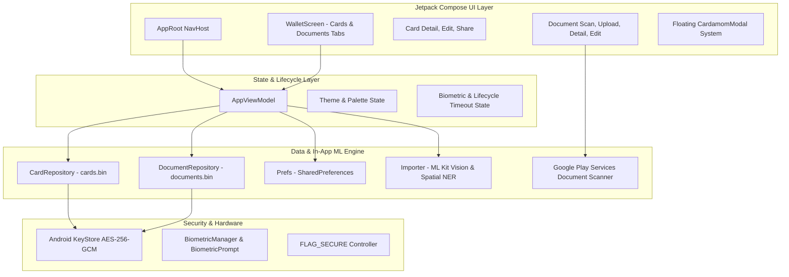
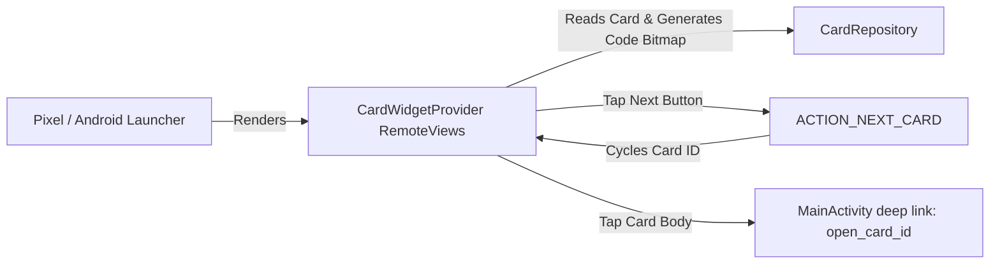

# Cardamom — Complete Architecture, Feature & Navigation Specification

This document provides a comprehensive, technical specification of all features, navigation screens, data models, security controls, and hardware integrations currently implemented in the **Cardamom** Android application (`com.shrivatsav.cardamom`).

---

## Table of Contents
1. [Application Overview & Architecture](#1-application-overview--architecture)
2. [Data Models & Schema](#2-data-models--schema)
3. [Local Persistence & Cryptography](#3-local-persistence--cryptography)
4. [Design System, Theming & Typography](#4-design-system-theming--typography)
5. [Custom Floating Modal Architecture](#5-custom-floating-modal-architecture)
6. [Complete Navigation Graph & Screen Registry](#6-complete-navigation-graph--screen-registry)
7. [Card Subsystem Specification](#7-card-subsystem-specification)
8. [Document Subsystem Specification](#8-document-subsystem-specification)
9. [Machine Learning & Analysis Engine](#9-machine-learning--analysis-engine)
10. [Home Screen AppWidget Subsystem](#10-home-screen-appwidget-subsystem)
11. [Security, Privacy & OS Integration](#11-security-privacy--os-integration)

---

## 1. Application Overview & Architecture

Cardamom is a private, offline-first digital wallet and personal document organizer built entirely using modern Android tools:
* **UI Toolkit**: Jetpack Compose with Material 3.
* **Architecture**: Android Architecture Components (ViewModel, StateFlow, Coroutines).
* **Language & Toolchain**: Kotlin 2.3.20, Java 17, JVM Toolchain 17, Target SDK 37, Min SDK 30.
* **Storage Philosophy**: 100% on-device storage encrypted with hardware-backed Keystore keys. Zero server tracking, zero external telemetry.



---

## 2. Data Models & Schema

All core entities are defined in `Model.kt`.

### 2.1 `CodeFormat` (Enum)
Supported 1D and 2D barcode symbologies mapping to both ZXing `BarcodeFormat` and Google ML Kit integer formats:
* `QR`: QR Code (2D)
* `CODE128`: Code 128 (1D)
* `CODE39`: Code 39 (1D)
* `CODE93`: Code 93 (1D)
* `CODABAR`: Codabar (1D)
* `EAN13`: EAN-13 (1D)
* `EAN8`: EAN-8 (1D)
* `UPCA`: UPC-A (1D)
* `UPCE`: UPC-E (1D)
* `ITF`: Interleaved 2 of 5 (1D)
* `PDF417`: PDF417 (2D)
* `AZTEC`: Aztec Code (2D)
* `DATAMATRIX`: Data Matrix (2D)

`is2D` returns `true` for `QR`, `PDF417`, `AZTEC`, and `DATAMATRIX`.

### 2.2 `LogoMode` (Enum)
Defines the visual badge displayed on a card tile:
* `AUTO`: Automatically fetched site favicon or generated card initials.
* `EMOJI`: Single emoji character selected by user.
* `IMAGE`: Custom image file imported by user.

### 2.3 `CardField` (Data Class)
Key-value pair for arbitrary dynamic attributes extracted by the in-app ML engine or defined manually:
* `label: String` (e.g., `"Department"`, `"Validity"`, `"Seat"`, `"Points"`)
* `value: String` (e.g., `"Computer Science"`, `"09/2029"`, `"F-12"`, `"1,450"`)

### 2.4 `WalletCard` (Data Class)
Represents a card entry stored in the wallet:
* `id: String`: UUID string identifier.
* `name: String`: Card title/name (left blank by default for user specification).
* `issuer: String`: Issuing organization, university, or company name (supports multi-line text).
* `website: String`: Associated domain used for automated favicon extraction.
* `category: String`: Categorization label (e.g., `"Library Card"`, `"Institutional ID"`, `"Movie Ticket"`, `"Loyalty Card"`, `"Card"`).
* `code: String`: Encoded barcode/QR payload (optional; cards can be saved without a code).
* `format: CodeFormat`: The barcode format enum (default `CodeFormat.CODE128`).
* `colorIndex: Int`: Randomly selected integer indexing into `C.CardColors`.
* `seed: Int`: Deterministic seed for generative card tile illustration canvas.
* `logoMode: LogoMode`: Selected logo mode.
* `emoji: String`: Emoji string if `logoMode == LogoMode.EMOJI`.
* `logoPath: String?`: Absolute path to cached website logo PNG.
* `customPath: String?`: Absolute path to user-imported logo PNG.
* `frontImagePath: String?`: Absolute path to cropped photo of the card's front side.
* `backImagePath: String?`: Absolute path to cropped photo of the card's back side.
* `fields: List<CardField>`: Dynamic attributes list.
* `points: String`: Legacy/direct points string.
* `status: String`: Legacy/direct tier or status string.
* `originalPath: String?`: Path to imported source image or PDF document.
* `originalName: String?`: Original display filename of imported file.
* `originalMime: String?`: MIME type of imported file.
* `isPinned: Boolean`: Whether this card is pinned at the top of the wallet (maximum 1 card across wallet).
* `isDocument: Boolean`: Flag distinguishing cards from standalone documents.
* `createdAt: Long`: Millisecond Unix timestamp of creation.

### 2.5 `WalletDocument` (Data Class)
Represents a standalone document stored in the Documents repository:
* `id: String`: UUID string identifier.
* `title: String`: User-facing document title (e.g., `"Passport"`, `"Fall 2026 Transcript"`).
* `docType: String`: Category (*National ID*, *Passport / Visa*, *Educational Certificate*, *Receipt / Invoice*, *Exit Permit*, *Health / Vaccine Record*, *Insurance Policy*, *Work Permit / Contract*, *Document*).
* `issuer: String`: Issuing authority or institution name (supports multi-line text).
* `uriPath: String`: File path to primary document image or imported PDF.
* `mimeType: String`: MIME type (`"application/pdf"` or `"image/jpeg"`).
* `pageCount: Int`: Total count of pages in document.
* `pagePaths: List<String>`: List of absolute file paths to JPEG images for each scanned page.
* `pdfPath: String?`: Path to compiled multi-page PDF document generated by scanner.
* `fileSize: Long`: Size of document file in bytes.
* `isPinned: Boolean`: Whether the document is pinned to top of documents list.
* `createdAt: Long`: Millisecond timestamp of creation.
* `fields: List<CardField>`: Extracted or custom key-value attributes.

---

## 3. Local Persistence & Cryptography

All persistence logic is encapsulated in `Storage.kt`.

### 3.1 Hardware-Backed `SecureStore`
* **Algorithm**: `AES/GCM/NoPadding` (256-bit key).
* **Key Storage**: AndroidKeyStore provider using alias `cardamom_key`.
* **Payload Structure**: 12-byte IV prepended directly to the ciphertext and 128-bit authentication tag (`GCMParameterSpec(128, iv)`).
* **Target Files**:
  * `cards.bin`: Encrypted JSON array of all `WalletCard` objects.
  * `documents.bin`: Encrypted JSON array of all `WalletDocument` objects.
* **Corrupted File Safeguard**: If `store.decrypt()` throws an exception (e.g. system key invalidation), the corrupted binary is preserved as `cards_corrupted_<timestamp>.bin` before returning an empty list, preventing silent data overwrite.

### 3.2 Repositories
* **`CardRepository`**: Thread-safe manager of `WalletCard` entries with reactive `StateFlow<List<WalletCard>>`. Automatically notifies home screen AppWidgets via `CardWidgetProvider.notifyUpdateAll(ctx)` upon any `upsert`, `saveAll`, or `delete`.
* **`DocumentRepository`**: Independent manager of `WalletDocument` entries with reactive `StateFlow<List<WalletDocument>>`. Cleans up all referenced page images and PDF files from disk upon deletion.

### 3.3 Password-Protected `Backup` Subsystem
* **File Header Magic**: String `"CARDAMOM1"`.
* **Key Derivation**: `PBKDF2WithHmacSHA256` running **120,000 iterations** with a 16-byte cryptographically secure random salt to derive a 256-bit AES key.
* **Format**: `MAGIC + salt(16) + iv(12) + ciphertext_and_tag`.
* **Export Payload**: Strips local filesystem paths to ensure portable import on other devices.

### 3.4 User Preferences (`Prefs`)
Stored in app-private `cardamom.xml` SharedPreferences:
* `userName: String`: Display username.
* `userAvatarPath: String?`: Absolute path to custom cropped user profile picture PNG.
* `onboarded: Boolean`: Flag tracking whether initial walkthrough has been completed.
* `lockEnabled: Boolean`: Master toggle for biometric / device credential authentication.
* `lockTimeoutSeconds: Long`: Inactivity grace duration before triggering lock (`0`, `15`, `60`, `300`).
* `screenSecurity: Boolean`: Toggle enforcing `FLAG_SECURE` against screenshots and recents snapshots.
* `illustrations: Boolean`: Toggle enabling generative background patterns on card tiles.
* `fetchLogos: Boolean`: Toggle permitting client-side favicon downloads over HTTPS.
* `theme: String`: Active appearance theme (`"SYSTEM"`, `"DARK"`, `"LIGHT"`).
* `pinnedCardId: String?`: Unique ID of the single card pinned to the top of the Cards tab.
* `pinnedDocId: String?`: Unique ID of the single document pinned to the top of the Documents tab.
* `lastBackup: Long`: Timestamp of last export.

---

## 4. Design System, Theming & Typography

Implemented across `Theme.kt` and `Components.kt`.

### 4.1 Typography Scale
* **Typeface**: `GoogleSansFlexFamily` loaded from `res/font/google_sans_flex.ttf`.
* **Variable Font Axes**:
  * `ROND = 100f`: Maximum rounded terminal styling across all glyphs.
  * `wght`: Explicitly mapped across `FontWeight.Normal` (400), `Medium` (500), `SemiBold` (600), and `Bold` (700).
* **Typography Roles**: 15 standard Material 3 roles wired into `CardamomTypography` and provided app-wide via `LocalTextStyle`.

### 4.2 Dynamic Color Palettes

```
                     ┌───────────────────────────────────┐
                     │          CardamomTheme            │
                     └─────────────────┬─────────────────┘
                                       │
                      isDark (System / Dark / Light)
                                       │
                    ┌──────────────────┴──────────────────┐
                    ▼                                     ▼
        ┌───────────────────────┐             ┌───────────────────────┐
        │      DarkPalette      │             │     LightPalette      │
        ├───────────────────────┤             ├───────────────────────┤
        │ bg:      #161616      │             │ bg:      #F8F6F1      │
        │ surface: #232323      │             │ surface: #FFFFFF      │
        │ text:    #FBF3E4      │             │ text:    #1A1917      │
        │ muted:   #A8A39A      │             │ muted:   #78746B      │
        │ outline: #3A3A3A      │             │ outline: #E4DFD5      │
        │ yellow:  #F5C842      │             │ yellow:  #E2B026      │
        │ danger:  #FF9C94      │             │ danger:  #DC362D      │
        └───────────────────────┘             └───────────────────────┘
```

* **Composable Color Access**: Global `object C` exposes `@Composable get()` properties backed by `LocalCardamomPalette.current`, enabling dynamic zero-overhead theme switching.
* **Card Pastel Palette**: Constant across themes:
  * `Orange = #F6B04B`
  * `Sage = #CFE0CC`
  * `Mint = #A8D8B4`
  * `Purple = #8B7CF6`
  * `Pink = #F08A8A`

---

## 5. Custom Floating Modal Architecture

Implemented in `Modal.kt`. Replaces all generic alert dialogs with a bespoke, floating modal card detached from all four screen edges.

### 5.1 `CardamomModal` (Base Container)
* **Floating Geometry**: Detached on all sides via `padding(horizontal = 16.dp, vertical = 20.dp)` with top status bar and bottom navigation bar insets.
* **Shape & Elevation**: `RoundedCornerShape(28.dp)` across all 4 corners, layered with a 20dp drop shadow over a 65% black scrim.
* **Neutral Dark Palette**: `tonalElevation = 0.dp` avoids Material 3 yellow cast; uses neutral `#1C1C1E` in dark mode and `#FFFFFF` in light mode, enclosed by a `1.5.dp` border.
* **Drag Indicator**: Centered 36x4dp rounded pill handle at top.

### 5.2 Specialized Modal Variants
* **`CardamomSelectModal<T>`**: Displays options as raised/muted pills. Selected options feature a raised dark surface, a 2dp gold border, and a circular gold checkmark badge.
* **`CardamomConfirmModal`**: Confirmation sheet for destructive operations (e.g., deleting cards or documents) with a red confirmation button.
* **`CardamomLinkModal`**: Sheet for viewing raw QR/barcode payloads with a one-tap "Copy to clipboard" button.

---

## 6. Complete Navigation Graph & Screen Registry

Implemented in `App.kt` using `androidx.navigation.compose.NavHost`.

| Route | Composable Function | Purpose / Description |
|---|---|---|
| `w1` | `WelcomeScreen` | Initial onboarding screen: branding, hero card fan animation, and "Get started" button. |
| `w2` | `ScanIntroScreen` | Second onboarding screen: visual illustration of code scanning capabilities and "Next" button. |
| `w3` | `UsernameScreen` | Final onboarding step: custom profile photo picker, username field, lock toggle, and "Create my wallet". |
| `wallet` | `WalletScreen` | Main home screen: dual-tab interface ("Cards" & "Documents"), search bar, user avatar, and pinned card. |
| `scan` / `scan?doc={doc}` | `ScanScreen` | Live camera scanner: custom ID-1 card cutout frame, 2-step (Front & Back) card capture, and photo/file import. |
| `review` | `ReviewScreen` | Post-scan card inspection: front/back thumbnail switcher, category, issuer, and dynamic attributes. |
| `edit/{id}` | `EditScreen` | Card editor: manual title, 2-line institution, category, website, colors, logos, and custom attributes. |
| `detail/{id}` | `DetailScreen` | Full card view: 2-line hero header, barcode panel, digital card vs front/back photo tabs, and attributes. |
| `share/{id}` | `ShareScreen` | Card sharing: export as rendered card PNG image, raw encrypted `.cardamom` file, or save to gallery. |
| `scan_doc` | `DocumentScanScreen` | Document import: Google Play Services Document Scanner launcher, PDF importer, and gallery picker. |
| `doc_upload` | `DocumentUploadScreen` | Document metadata screen: shows captured preview thumbnail, title input, doc type picker, and "Upload document". |
| `doc_detail/{id}` | `DocumentDetailScreen` | Document viewer: renders actual scanned pages/PDFs with full-screen zoom, document attributes, and share. |
| `doc_edit/{id}` | `DocumentEditScreen` | Document metadata editor: modify title, type, authority, and custom attributes. |
| `settings` | `SettingsScreen` | App configuration: profile details & avatar, app lock toggle, lock timeout, screen security, and theme modal. |
| `backup` | `BackupScreen` | Encrypted file export & import: password encryption, JSON export, and full wallet restoration. |
| *(Overlay)* | `UnlockScreen` | Full-screen security barrier active whenever `vm.locked == true`. Enforces biometric / device credentials. |
| *(Overlay)* | `BusyOverlay` | Non-blocking modal loading spinner with status text shown during long IO or ML operations. |

---

## 7. Card Subsystem Specification

Implemented in `ScreensMain.kt`, `ScreensCard.kt`, and `Components.kt`.

### 7.1 Single Pinned Hero Card (Always Open at Top of Cards Tab)
* Enforced by `AppViewModel.pinnedCardId`: Only **one** card can be pinned at any time on the Cards tab.
* Renders at index 0 of the **Cards tab** with `expanded = true` **permanently**: its barcode, loyalty balance, or attributes remain expanded and ready to scan immediately.
* Labeled with a gold pin icon and `"Pinned"` label with a dark pill `"Unpin"` button.
* Tapping on the barcode/QR code on the home screen card opens `DetailScreen`. In `DetailScreen`, tapping the QR code again opens the `"Code contents"` copy modal.
* Tapping the 5-point gold star icon on any card's detail screen immediately pins that card and unpins any prior selection.

### 7.2 Custom Two-Way Scanner (Front & Back of Card)
* **Viewfinder Frame (`CardFrameOverlay`)**: Renders an exact ID-1 card cutout ($1.586 : 1$ aspect ratio) with 24dp rounded corners, outer canvas dimming, and real-time green border highlight when barcodes are detected.
* **Two-Step Guided Flow**:
  * *Step 1 (Front)*: Prompts to align front of card. Tapping **"Capture Front"** crops the bitmap strictly to the card frame.
  * *Step 2 (Back)*: Viewfinder switches to back framing. Tapping **"Capture Back"** crops the back side, or tapping **"Skip back side"** proceeds with front-only data.
* **Storage**: Cropped card images are stored locally as `card_<id>_front.jpg` and `card_<id>_back.jpg`.

### 7.3 Multi-View Card Inspection (`DetailScreen`)
* **Header**: Two-line hero typography (`maxLines = 2`, `lineHeight = 26.sp`) for long university and corporate names.
* **View Mode Selector**: If scanned photos exist, tabs toggle between:
  1. `Digital card`: High-contrast vector styling with screen brightness boost and barcode.
  2. `Front photo`: High-resolution cropped image of the card's front side.
  3. `Back photo`: High-resolution cropped image of the card's back side.
* **Code-Optional Handling**: Cards without barcodes omit the code container entirely.
* **Two-Line Attributes (`CardAttributeTwoLine`)**: Fields such as Institution, Company, or values exceeding 22 characters render with a small uppercase label on line 1 and full-width multi-line text on line 2.

### 7.4 Home Screen Card Tile (`CardTile`)
* **Direct Typography**: Omits generic avatar initials and icons in front of names; titles and issuers start cleanly aligned to the card edge.
* **Minimized State**: Displays 2-line title/issuer and a **mini barcode/QR code preview** in the top-right corner.
* **Expanded State**: Smoothly unfolds inline to show the full-size `CodePanel` and `CardFieldsRow`. Tapping the QR code opens the card detail screen.

---

## 8. Document Subsystem Specification

Implemented in `ScreensDocument.kt`.

### 8.1 Complete Architectural Separation
Documents represent distinct legal, educational, and financial records and do not share card styling, seeds, or barcode panels.

### 8.2 Document Capture (`DocumentScanScreen`)
1. **Google Play Services Document Scanner**:
   * Uses `GmsDocumentScanning.getClient()` configured with `SCANNER_MODE_FULL`, `setGalleryImportAllowed(true)`, and `setPageLimit(20)`.
   * Automatically executes document corner detection, perspective unwarping, shadow removal, and generates both clean page JPEGs and a compiled PDF.
2. **Import PDF**: Opens system file picker for native PDF documents.
3. **Photo Gallery**: Imports high-resolution document photos.

### 8.3 Document Upload Screen (`DocumentUploadScreen`)
* Triggered immediately upon capture or file selection (no silent auto-saving).
* Displays a live visual thumbnail of the captured document.
* Prompts the user for:
  * **Document title**: Custom user-defined name.
  * **Document type**: Selectable modal (*National ID*, *Passport / Visa*, *Educational Certificate*, *Receipt / Invoice*, *Exit Permit*, *Health Record*, *Insurance*, *Contract*, *Document*).
  * **Issuing authority / Organization**: Multi-line organization name.
* Action button: **"Upload document"** persists the record into the encrypted document vault.

### 8.4 Document Viewer (`DocumentDetailScreen`)
* **Rearranged Layout**: Positions the **TYPE & ISSUER details card directly below the top bar**, placing key metadata at the top of the screen before the document preview.
* **Native Aspect Ratio (No Zoom/Cropping)**: Displays the document page in its exact original aspect ratio (16:9, 9:16, 4:3, etc.) using `ContentScale.Fit`, ensuring zero distortion, zoom, or clipping.
* **Tap-to-Zoom**: Tapping the document container launches `DocumentFullViewerDialog`, displaying all pages in an interactive, full-screen viewer.
* **Share**: One-tap native sharing via Android `FileProvider`.

### 8.5 Inline Home Screen Document Previews & Single Pinned Hero Document
* **Single Pinned Hero Document**: Enforced by `AppViewModel.pinnedDocId`: Only **one** document can be pinned at any time on the Documents tab. Renders permanently expanded at index 0 of the Documents tab with a gold pin icon, `"Pinned"` label, and an `"Unpin"` button.
* **Responsive Full Image View**: When expanded, removes the split one-page layout. The document image is displayed full-width, dynamically scaling to landscape or portrait/vertical proportions as the image takes.
* **1-Tap Navigation**: Tapping the document image or the black pill **"View"** button navigates directly to `DocumentDetailScreen`.
---

## 9. Machine Learning & Analysis Engine

Implemented in `Importer.kt`. Fully self-contained within the application APK without reliance on cloud APIs or OS-level services.

### 9.1 Barcode Vision
* Uses Google ML Kit `BarcodeScanning.getClient()` to process input bitmaps and extract all 1D/2D codes across both front and back captures.

### 9.2 Spatial Layout Text Recognition
* Uses Google ML Kit `TextRecognition.getClient(TextRecognizerOptions.DEFAULT_OPTIONS)`.
* Retains text block line geometry and reading order.

### 9.3 In-App NLP & Entity Extraction Pipeline
1. **Two-Line Organization & Issuer Detection**:
   * Inspects adjacent lines on the card face against organizational markers (`University`, `College`, `Institute`, `School`, `Hospital`, `Corporation`, `Cinemas`, `Airlines`, `Bank`, `Library`, `Authority`, `Transit`).
   * Assembles split lines (e.g. `STANFORD` + `UNIVERSITY`, `SAN JOSE STATE` + `UNIVERSITY`, `UNIVERSITY OF CALIFORNIA` + `BERKELEY`) into natural multi-line strings.
2. **Archetype Classification**:
   * Evaluates lexical features to classify records into *Library Card*, *Institutional ID*, *Movie Ticket*, *Event Ticket*, *Flight Ticket*, *Transit Pass*, *Loyalty Card*, *Membership*, *Coupon*, or *Card*.
3. **Dynamic Field Parsing**:
   * *Department*: Strips abbreviations and punctuation; validates $\ge 2$ alphanumeric characters.
   * *Validity Dates*: Prioritizes 4-digit year dates (`MM/YYYY`, `YYYY-YYYY`) to prevent truncated fragments.
   * *Ticket Coordinates*: Extracts `Screen`/`Audi`, `Seat` (*e.g. F-12*), `Row`, and `Showtime`.
   * *Loyalty Attributes*: Extracts `Available Points`, `Min/Max Points`, `Tier` (*Gold, Platinum*), and `Member ID`.
   * *Flight Coordinates*: Extracts `Flight No`, `Gate`, `Seat`, and `Route` (*e.g. SFO to JFK*).
4. **Blank Defaults for User Input**:
   * Card Title and ID Number are left blank by default, preventing noisy OCR misclassifications from pre-populating fields.

---

## 10. Home Screen AppWidget Subsystem

Implemented in `CardWidgetProvider.kt`, `CardWidgetConfigureActivity.kt`, and `res/layout/widget_card.xml`.



### 10.1 Live Code & Barcode Preview
* Renders the card's actual 1D barcode or 2D QR code at high resolution directly on the home screen using `Codes.bitmap(...)`.
* Displays card background color, 2-line title/issuer, and category.

### 10.2 Custom Configuration Activity (`CardWidgetConfigureActivity`)
* Launched when adding a widget.
* Built in Jetpack Compose: shows all wallet cards with expandable previews, allowing the user to pick which card appears on that specific widget instance.
* Instance mapping is persisted via `cardamom_widgets.xml` SharedPreferences (`card_widget_<appWidgetId>`).

### 10.3 In-Widget Card Cycling
* Tapping the top-right button on the widget triggers `ACTION_NEXT_CARD`, cycling to the next card in the wallet and updating the live barcode preview without opening the app.

### 10.4 1-Tap Deep Linking
* Tapping the widget body launches `MainActivity` with `open_card_id`, opening the card's detail view directly with full screen brightness boost.

---

## 11. Security, Privacy & OS Integration

### 11.1 Biometric & Lifecycle Authentication
* Handled via `Auth.prompt` using AndroidX `BiometricPrompt` with `BIOMETRIC_STRONG or DEVICE_CREDENTIAL`.
* **Configurable Lock Timeout**: Enforced by `AppViewModel.onBackground()` and `onForeground()`:
  * `Immediately`: Locks as soon as the app enters the background.
  * `15 seconds`: Grace period allowing quick app switching.
  * `1 minute` / `5 minutes`: Extended grace durations.

### 11.2 Screen Security (`FLAG_SECURE`)
* Toggled via **Settings $\to$ Security $\to$ "Block screenshots & recents"**.
* Dynamically sets `WindowManager.LayoutParams.FLAG_SECURE` in `MainActivity` whenever screen security is active or whenever the app is locked.
* **Protection**: Blocks screenshots and blanks out the app preview in the Android Recent Tasks (Overview) switcher.

### 11.3 System Bar Styling & Navigation Insets
* Full edge-to-edge layout via `enableEdgeToEdge()`.
* Automatically toggles status bar icons and navigation bar handle between light and dark according to the active theme.
* All screens and floating modals consume `systemBarsPadding()`, `navigationBarsPadding()`, and `imePadding()` to prevent UI overlap.

### 11.4 Launcher App Shortcuts
* Registered in `res/xml/shortcuts.xml`: Long-pressing the app icon exposes the **"Scan Card"** shortcut, navigating directly to the camera scanner in one tap.

### 11.5 Material You Themed Icon
* `res/mipmap-anydpi-v26/ic_launcher.xml` and `ic_launcher_round.xml` include `<monochrome android:drawable="@drawable/ic_launcher_foreground" />`, adapting to wallpaper color palettes on Android 13+.

---

## Summary of Key Source Files

```
cardamom/app/src/main/
├── AndroidManifest.xml                        # Manifest, permissions, activities, receivers, FileProvider
├── java/com/shrivatsav/cardamom/
│   ├── App.kt                                # MainActivity, NavHost routes, lifecycle, edge-to-edge
│   ├── AppViewModel.kt                       # Observable state, card/doc operations, theme, lock timeout
│   ├── Model.kt                              # WalletCard, WalletDocument, CardField, CodeFormat, JSON
│   ├── Storage.kt                            # SecureStore (AES-GCM), CardRepository, DocumentRepository, Backup
│   ├── Util.kt                               # Auth (Biometrics), Codes (ZXing), Files, Favicon (HTTPS)
│   ├── Theme.kt                              # Dark/Light palettes, GoogleSansFlexFamily, CardamomTypography
│   ├── Modal.kt                              # Floating CardamomModal, CardamomSelectModal, CardamomConfirmModal
│   ├── Components.kt                         # AppButton, Choice, CField, Switch, CardTile, UserAvatar
│   ├── ScreensMain.kt                        # WalletScreen (Cards/Docs tabs), CameraPreview, ScanScreen, Review
│   ├── ScreensCard.kt                        # EditScreen, DetailScreen (photo tabs), ShareScreen, InAppFileViewer
│   ├── ScreensDocument.kt                    # DocumentTile (inline preview), DocumentScan, Upload, Detail, Edit
│   ├── ScreensOnboarding.kt                  # WelcomeScreen, ScanIntroScreen, UsernameScreen (avatar), UnlockScreen
│   ├── ScreensSettings.kt                    # SettingsScreen (avatar, theme, timeout, security), BackupScreen
│   ├── CardWidgetProvider.kt                 # AppWidgetProvider for home screen widget with code preview
│   └── CardWidgetConfigureActivity.kt        # AppWidget configuration activity with Compose card picker
├── res/
│   ├── layout/widget_card.xml                # RemoteViews layout for home screen widget
│   ├── xml/card_widget_info.xml              # AppWidgetProviderInfo metadata
│   ├── xml/shortcuts.xml                     # Launcher App Shortcuts metadata
│   ├── xml/file_paths.xml                    # FileProvider scoped storage paths
│   └── font/google_sans_flex.ttf             # Variable font TTF with ROND=100f
└── proguard-rules.pro                        # R8 keep rules for models, ML Kit, ZXing, CameraX
```
